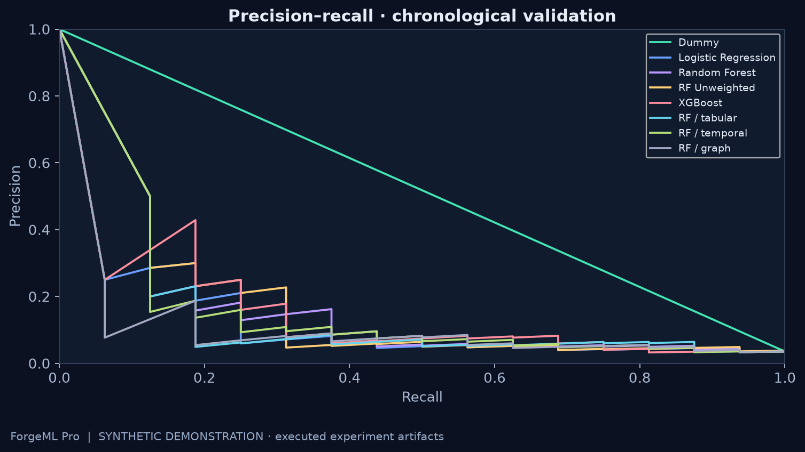
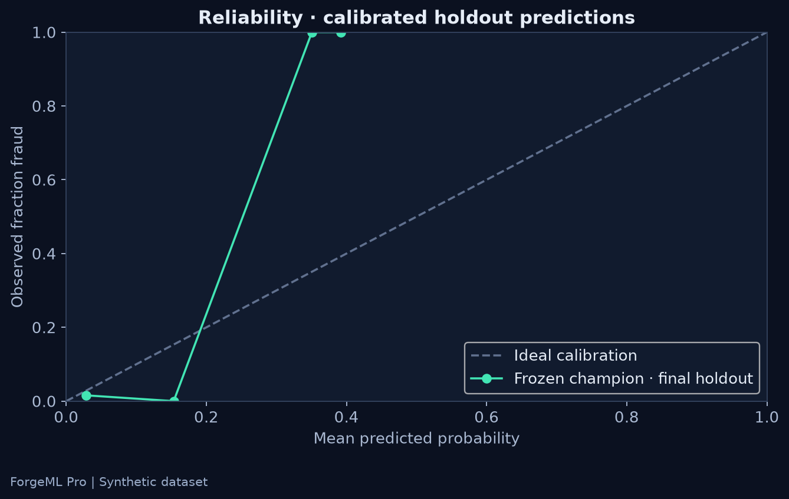
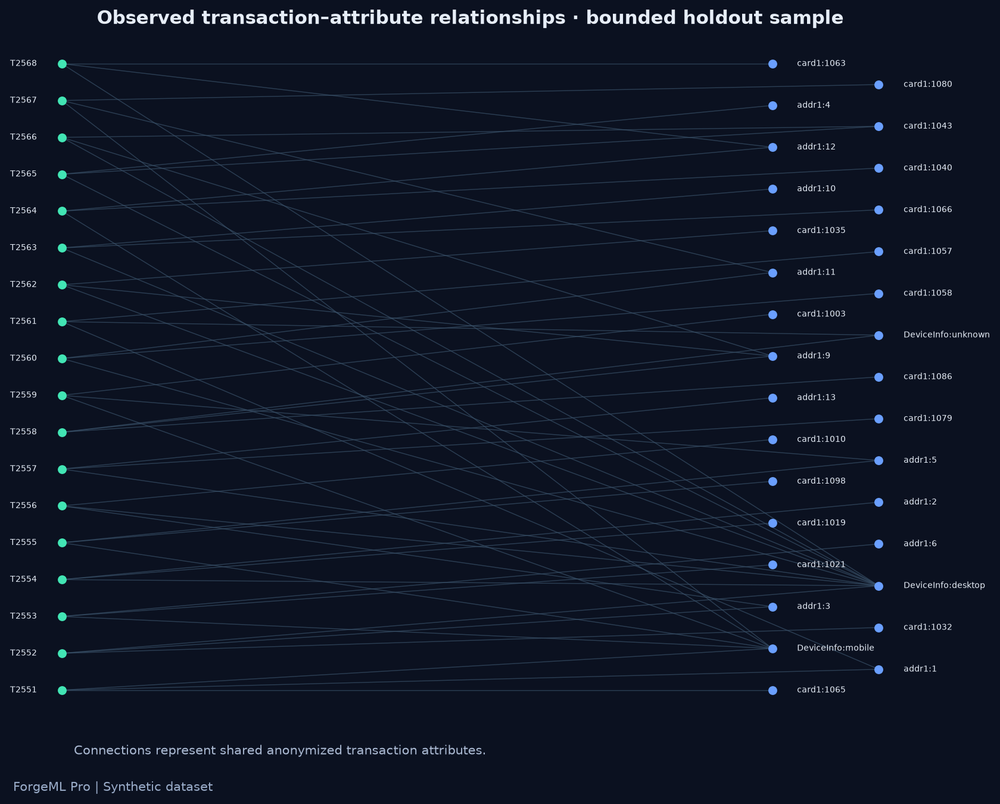
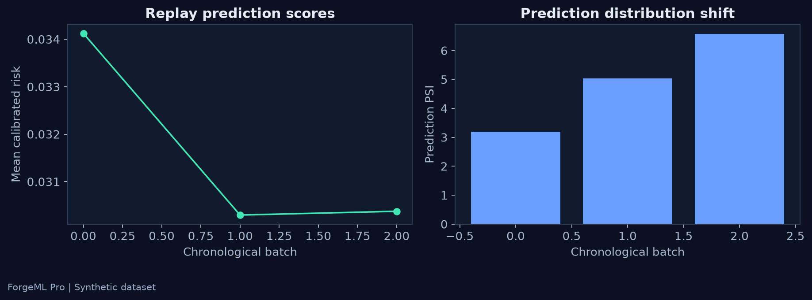
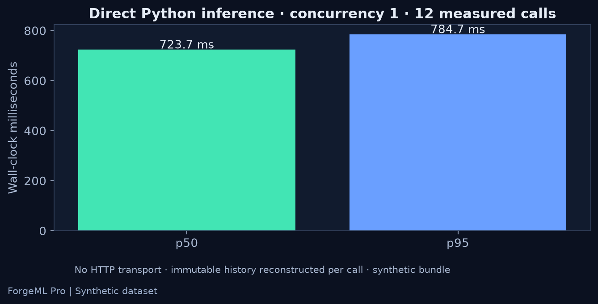

<div align="center">

# ForgeML Pro
### A student project in fraud detection and ML engineering

**Explore how fraud models behave over time—from features and experiments to a dashboard and model checks.**

Python 3.11+ · scikit-learn · XGBoost · FastAPI preferred · local dashboard · Docker configuration


**Historical-data simulation. Current artifacts use synthetic data. No banking deployment is claimed.**

[Quick start](#reproduce-the-project) · [Results](#measured-experiments) · [Demo](docs/demo-script.md) · [Verification](VERIFICATION.md) · [Model card](docs/model-card.md)

</div>

## Project goal

This project explores a practical ML question: **can past transaction behavior and shared attributes improve fraud detection, and how should a model be evaluated before it is used?**

The focus is on learning and demonstrating sound ML engineering: prevent future-data leakage, compare simple and advanced methods, explain tradeoffs, and keep experimental results reproducible. The system is a local portfolio demonstration.

[Student project report](docs/student-project-report.md) · [Code and interview guide](docs/student-guide.md)

## Implementation

ForgeML is a working offline ML pipeline with a versioned inference bundle and a six-view dashboard implementation. The current run trained eight candidate configurations on **3,000 synthetic transactions** and evaluated the frozen calibrated champion on **450 later transactions**. It is an engineering demonstration, not an IEEE-CIS leaderboard result.

- **Past-only features:** transaction transformations, card behavior, rolling activity and graph connectivity; same-time observations cannot see one another.
- **Controlled experiments:** dummy/logistic/RF/XGBoost comparisons, RF feature-group ablations and weighted/unweighted RF comparison.
- **Decision policies:** calibrated probabilities, assumed-cost threshold, precision-constrained threshold selection and exact top-K review budgets.
- **Governance:** offline trained challenger, a separate forward comparison period, quality/calibration/latency gates, audit history and rollback mechanics.
- **Monitoring:** chronological replay, simulated delayed labels, feature/prediction PSI and missingness diagnostics.
- **Evidence:** trained bundles, dataset fingerprint, split boundaries, recorded metrics, reproducible figures and tests.

**Verification boundary:** core ML and direct service logic were executed. HTTP serving, browser screenshots and Docker execution were blocked by this environment. Optional LightGBM, Optuna, MLflow, SHAP and Evidently code paths exist but their packages were unavailable. See the exact matrix in [VERIFICATION.md](VERIFICATION.md). No passing CI or deployment badge is claimed.

## Measured experiments


Validation scores below use the same chronological development interval. The selected model is **RF Unweighted**. These scores are for selection; the final holdout is reported separately.

| Candidate | Validation AP | ROC-AUC | Brier | Fit time |
|---|---:|---:|---:|---:|
| Dummy | 0.0356 | 0.5000 | 0.0343 | 0.25s |
| Logistic Regression | 0.1286 | 0.6365 | 0.1811 | 0.09s |
| Random Forest | 0.1574 | 0.6823 | 0.1785 | 0.28s |
| RF Unweighted | 0.2153 | 0.6542 | 0.0326 | 0.21s |
| XGBoost | 0.1901 | 0.6696 | 0.0327 | 0.27s |
| RF / tabular | 0.1269 | 0.6695 | 0.1882 | 0.18s |
| RF / temporal | 0.1370 | 0.6740 | 0.1789 | 0.18s |
| RF / graph | 0.0877 | 0.6649 | 0.2055 | 0.15s |

| Frozen calibrated champion | Final holdout result |
|---|---:|
| Average precision | 0.3323 |
| ROC-AUC | 0.6457 |
| Brier score | 0.0185 |
| Raw probability Brier | 0.0203 |
| Precision / recall at cost policy | 0.0862 / 0.5000 |
| Decision threshold | 0.047619 |

The fixture deliberately contains artificial signal. Do not use these values to claim effectiveness on real fraud, statistical significance, financial savings, or production readiness. Few positive cases make the estimates unstable.

<table><tr><td></td><td></td></tr></table>

The precision–recall figure compares validation candidates. The reliability figure shows the frozen champion's final holdout predictions. [Raw experiment JSON](artifacts/report.json) includes full metric definitions and actual curve points.

## How the project works

The offline path joins authorized local CSVs, validates IDs, creates chronological features, trains candidates, calibrates the chosen estimator and freezes a bundle. The online implementation loads that trusted bundle, validates Pydantic requests, returns risk/policy/model metadata and records aggregate telemetry. The preferred server is FastAPI; an explicit Starlette fallback supports offline environments and reports its framework honestly.

A bundle contains preprocessing, estimator, feature list/group, unlabeled history snapshot, probability calibrator, policy threshold/version, schema and dataset fingerprint. Unknown categories are ignored by the fitted encoder. There is no request-time training.

Serving uses an immutable history snapshot; replay advances its own in-memory history. Feature reconstruction currently scales poorly for singleton serving. See [methodology](docs/methodology.md) for the availability contract and limitations.

## Dashboard gallery and live views

The frontend is a responsive, dependency-free HTML/CSS/JavaScript implementation, chosen to run locally without a Node build chain. All live views read real backend artifacts; mutations call real backend endpoints. It is an explicit alternative to the preferred Next.js stack.

| View | Actual data and interaction |
|---|---|
| Overview | Labeled prevalence, holdout summary, split periods, replay activity |
| Model laboratory | Validation comparisons, PR curves, reliability and feature ablations |
| Prediction explorer | Validated example request, actual probability and policy/version metadata |
| Graph intelligence | Bounded generated transaction–attribute graph |
| Drift and monitoring | Replay windows, PSI, alert rate and delayed-label quality |
| Model governance | Champion/challenger evidence, gated evaluation, rejection and rollback controls |

**Browser screenshots are not included:** local HTTP could not start and the browser blocked local-file URLs. There are no synthetic software screenshots. The standalone [offline artifact viewer](frontend/snapshot.html) embeds actual JSON artifacts, clearly labels itself offline, and disables inference/actions. Its content was checked programmatically; visual browser QA remains blocked.

Run the server locally, follow [the screenshot checklist](docs/assets/SCREENSHOTS.md), and add genuine captures. The research figures elsewhere in this README are generated plots, not dashboard screenshots.

## Dataset and leakage prevention

IEEE-CIS is the intended real dataset. Authorized `train_transaction.csv` and `train_identity.csv` are required under `data/raw/`; neither is included or committed. The current fallback is clearly labeled **SYNTHETIC DEMONSTRATION** throughout artifacts and UI.

| Period | Rows | Relative TransactionDT boundaries |
|---|---:|---|
| train | 1650 | 0–296820 |
| validation | 450 | 297000–377820 |
| calibration | 225 | 378000–418320 |
| governance | 225 | 418500–458820 |
| test | 450 | 459000–539820 |

Preprocessing fits only on training. Validation selects candidates; a separate later period fits calibration. Governance uses its reserved forward window and never the final test period. Historical features see strictly earlier unlabeled observations. `TransactionDT` is a relative offset, not a real calendar timestamp. The stored champion has a tested serialization/evaluation parity contract.

## Graph research



The feature graph links observed card, address and device attributes. Its historical degree/component statistics feed the tabular model; no GNN is claimed. Missing attributes do not become one shared customer identity.

Compare **RF / tabular**, **RF / temporal**, **RF / graph** and **Random Forest** in the table above for the controlled ablation. Graph features are not presumed beneficial; retain the measured negative or positive finding for each real-data experiment. A bounded display graph is distinct from the graph used for chronological features.

## Explainability

An optional SHAP integration writes selected-tree local/global explanation artifacts when the package is available. **SHAP did not execute here** because the package could not be installed. The UI shows an unavailable state rather than invented contributions. A recorded explanation panel is separate from an interactive request and must not be interpreted as that request's explanation. Contributions explain the estimator, not causal fraud mechanisms; calibration changes the probability interpretation.

## API demonstration

```powershell
python -m uvicorn forgeml.api:app --host 127.0.0.1 --port 8000
```

```bash
curl http://127.0.0.1:8000/ready
curl -X POST http://127.0.0.1:8000/predict \
  -H "Content-Type: application/json" \
  -d '{"TransactionID":90001,"TransactionDT":600000,"TransactionAmt":125.5,"card1":1001,"ProductCD":"W"}'
```

Endpoints: `GET /health`, `/ready`, `/model-info`, `/metrics`; `POST /predict`, `/predict-batch`; dashboard data and controls under `/api/`. Predictions return fraud probability, risk category, recommendation, threshold/policy version, model version, request ID and latency. Labels are rejected as input. Batch size is bounded to 512. No fabricated HTTP response is shown: transport verification was blocked here. Tests separately verified actual trained-bundle inference and service handlers.

## Monitoring and guarded retraining



The replay runs chronological windows against the actual bundle, withholds labels until their simulated delay and records drift separately from delayed outcome quality. An explicitly induced amount shift can demonstrate a covariate warning; drift alone does not prove performance loss.

The challenger is trained offline on eligible earlier development data. It is evaluated on the same reserved governance window as the champion. Promotion gates are AP gain ≥0.005, Brier regression ≤0.02 and batch mean per-row latency ≤250 ms. The current synthetic challenger is **rejected**; successful promotion and rollback are verified using separate test fixtures. No empirical improvement is invented to force a promotion demo.

MLflow and Evidently adapters are implemented but unexecuted. The actually verified tracking evidence is the JSON artifact set and local registry, not an MLflow server. Audit files use process-local locking and are not a distributed registry.

## Performance



| Actual measurement | Value |
|---|---:|
| Direct Python p50 | 723.7 ms |
| Direct Python p95 | 784.7 ms |
| Sequential throughput | 1.36 calls/s |
| Measured calls / warmup / concurrency | 12 / 1 / 1 |
| History snapshot | 2550 rows |

Hardware: `Intel64 Family 6 Model 183 Stepping 1, GenuineIntel`, `Windows-10-10.0.26300-SP0`. This is singleton direct-bundle inference including historical feature reconstruction. **It is not an API load test.** Reproduce with `python -m scripts.benchmark_bundle`. The implemented HTTP load script is `python -m scripts.benchmark --requests 100 --concurrency 4`; it remains unexecuted here.

## Reproduce the project

```powershell
python -m venv .venv
.\.venv\Scripts\Activate.ps1
python -m pip install -e ".[dev,research]"
python -m scripts.train --rows 3000 --trials 3
python -m scripts.plot_results
python -m scripts.build_snapshot
python -m pytest -q --basetemp .test-tmp
python -m ruff check .
node scripts/check_frontend.mjs
python -m uvicorn forgeml.api:app --host 127.0.0.1 --port 8000
```

With authorized real CSVs: `python -m scripts.train --data-dir data/raw --trials 3`. Full-data compute use is unverified. Training replaces the active artifact set and archives the prior registry; use a fresh `--output-dir` for separate experiments. Artifacts generated by future runs will differ; rebuild plots and snapshot after training.

Docker configuration: `docker compose up --build`; Docker was absent here and container execution is unverified. CI runs training/tests/lint/frontend checks and a container smoke test when pushed; CI has not run remotely. No GitHub repository was created or published.

The original build reused existing local Python packages after network installation failed. Those machine-specific paths are not required by project source. A fresh environment requires dependency access; `artifacts/runtime-versions.json` records versions used for executed tests.

## What remains to improve

- Authorized IEEE-CIS experiments, real holdout results and full-scale resource validation remain blocked on data.
- FastAPI/LightGBM/Optuna/MLflow/SHAP/Evidently package execution needs dependency access.
- HTTP integration, browser interaction/screenshots, API benchmarks and Docker smoke require a normal local runtime.
- Feature history reconstruction needs a tested stateful serving implementation before low-latency claims.
- No authentication, distributed registry, durable streaming state, uncertainty intervals, fairness study, production deployment or live financial integration is claimed.
- Add repeated forward validation and justified uncertainty estimates before treating small changes as reliable improvements.

[Implementation status](VERIFICATION.md) · [Verification matrix](VERIFICATION.md) · [Methodology](docs/methodology.md) · [Model card](docs/model-card.md) · [Demo walkthrough](docs/demo-script.md)
