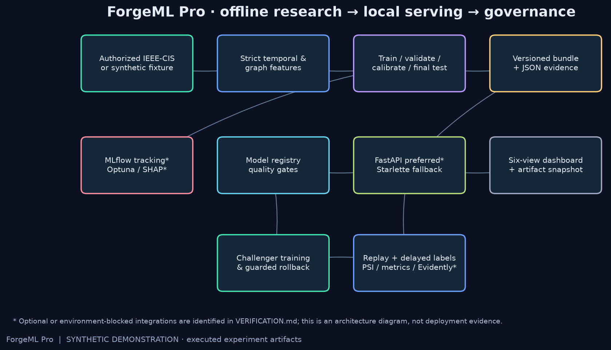
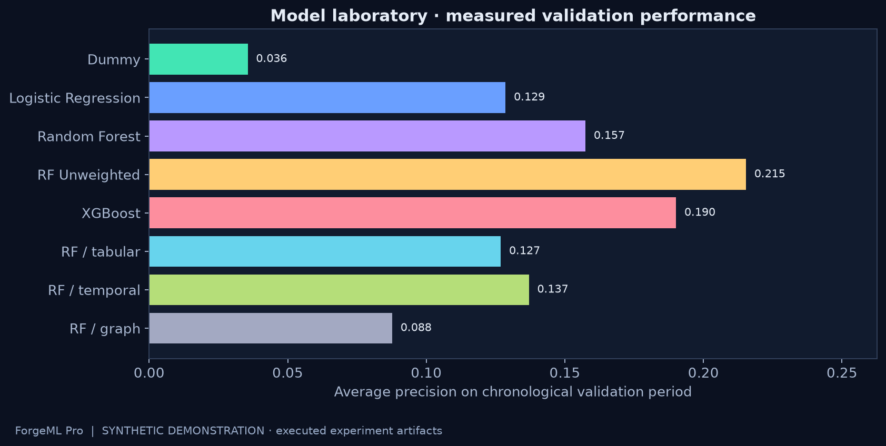

# ForgeML Pro

A machine learning project that explores fraud detection using transaction history.
It includes model training, an API and a dashboard for exploring predictions and results.

**The checked-in results use synthetic data.** They show that the workflow runs; they are not evidence of accuracy on real bank transactions. The IEEE-CIS dataset is not included.



## What the project does

- Compares a dummy baseline, logistic regression and random forests, with optional boosting models.
- Builds transaction features using only earlier events, then evaluates on later transactions.
- Calibrates model scores and chooses a decision threshold on a separate period.
- Serves predictions through an API and displays results in a six-page dashboard.
- Replays historical transactions to explore drift and delayed labels.
- Checks a candidate model before replacing the current model, with a local rollback option.

This is a local learning project. The model registry is a JSON file, and the API is intended to run on your own machine.

## Run it locally

Use Python 3.11 or newer. From the project folder in PowerShell:

```powershell
python -m venv .venv
.\.venv\Scripts\Activate.ps1
python -m pip install -e ".[dev,boosting]"
python -m scripts.train --rows 3000
python -m uvicorn forgeml.api:app --host 127.0.0.1 --port 8000
```

On macOS or Linux, activate the environment with `source .venv/bin/activate` instead.
Open **http://127.0.0.1:8000** for the dashboard or **http://127.0.0.1:8000/docs** for the FastAPI documentation.
Training creates the model files locally; those binary files are not kept in Git.

The dashboard has pages for results, model comparison, predictions, transaction relationships, replay and model versions.
A recorded, read-only view is also available in `frontend/snapshot.html`. It cannot make new predictions.

## Recorded results

The saved run contains **3,000 synthetic transactions**, with seed **42**.
The final test period was held apart from model selection and calibration.

| Test metric | Value |
| --- | ---: |
| Average precision | 0.3323 |
| ROC AUC | 0.6457 |
| Brier score | 0.0185 |

These are small-sample demo results, not a real-world performance claim. Re-running with different dependency versions can change the results.
The full experiment is saved in `artifacts/report.json`.



The images in this README are diagrams and plots generated from the project, not screenshots of a deployed service.

## Use the IEEE-CIS dataset

Download the competition files through your own authorized Kaggle account and place `train_transaction.csv` and `train_identity.csv` in `data/raw/`.
Then run:

```powershell
python -m scripts.train --data-dir data/raw --output-dir runs/ieee
$env:FORGEML_ARTIFACT_DIR = "runs/ieee"
python -m uvicorn forgeml.api:app --host 127.0.0.1 --port 8000
```

Raw data and `runs/` are ignored by Git. Keep real-data outputs separate from the committed synthetic demo.
This dataset has not yet been used to validate the checked-in results.

## Checks and Docker

```powershell
python -m pytest -q
python -m ruff check .
node scripts/check_frontend.mjs
docker build -t forgeml .
docker run --rm -p 127.0.0.1:8000:8000 forgeml
```

Train before building the container so it can include the local model bundle.
GitHub Actions runs training, tests and a container smoke check on each push.
See [verification notes](VERIFICATION.md) for the latest checks and limitations.

## Project files

| Folder | Contents |
| --- | --- |
| `forgeml/` | Data loading, features, training, prediction API and model checks |
| `frontend/` | Dashboard HTML, CSS and JavaScript |
| `scripts/` | Training, reports and checks |
| `tests/` | Tests for leakage, predictions, validation and model changes |
| `artifacts/` | Recorded synthetic results and plots' source data |
| `docs/` | Methodology, model card and walkthrough |

## Limits and next steps

- Run and evaluate the full workflow on authorized IEEE-CIS data.
- Add repeated forward validation; a single small holdout is not enough to establish reliability.
- Test the dashboard in a browser and add actual screenshots.
- Add authentication and a shared registry before considering a multi-user service.

Optional research integrations can be installed with `python -m pip install -e ".[research]"`.
They include Optuna, SHAP, MLflow and Evidently; availability and outputs depend on installed packages. They are not required to explore the basic project.

More detail: [methodology](docs/methodology.md), [model card](docs/model-card.md), [demo walkthrough](docs/demo-script.md).
